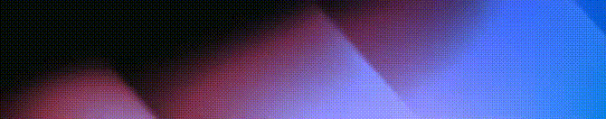

  <h1>Veil - A cleaner, quieter GNOME panel</h1>

  

  
  

  Hide the items you don't need on your GNOME panel. A modern successor to <a href="https://github.com/fablevi/HideItems">Hide Items</a>.

  

## Features

- **Selective tray**: when collapsed, only the status icons you pick stay visible
- **Click or hover**: toggle the tray with the Veil indicator, or show every icon while the pointer is over the status area
- **Auto-hide**: collapse the tray again after a delay (click mode)
- **Animations**: optional fade and slide with configurable duration and scope
- **Tighter status spacing**: lower the padding between top-bar indicators
- **Coexists with other applets**: icons hidden by their own extension stay hidden when the tray expands

Works on GNOME 46 to 51.

## Installation

Install Veil from the [GNOME Extensions store](https://extensions.gnome.org/extension/8786/veil/).

Or by hand:

1. Download the `.shell-extension.zip` from the [latest release](https://github.com/dagimg-dot/veil/releases/latest)
2. Install it with `gnome-extensions install --force <filename>`
3. Log out and back in
4. Enable Veil in the Extensions app

## If an icon does not behave as expected

Turn **Veil off**, use the **other extension's own settings** to hide its panel icon, then turn **Veil on** again. Veil then treats that item as externally hidden and will not reveal it when the tray expands.

## Development

See [DEVELOPMENT.md](./DEVELOPMENT.md).

## Credits

Status-area horizontal spacing is adapted from [Status Area Horizontal Spacing](https://gitlab.com/p91paul/status-area-horizontal-spacing-gnome-shell-extension) (original extension by Amy Chan / mathematical.coffee@gmail.com; maintained on GitLab by p91paul).

Panel icons in the preview come from [Activity Watch](https://activitywatch.net), [Net Speed Simplified](https://extensions.gnome.org/extension/3724/net-speed-simplified/), [Astra Monitor](https://extensions.gnome.org/extension/6682/astra-monitor/), [Pop Shell](https://github.com/pop-os/shell), [Power Indicator](https://extensions.gnome.org/extension/1501/power-indicator/) and [Easy Effects Preset Switcher](https://github.com/wwmm/easyeffects).

## License

MIT. See the [license](./LICENSE) for details.
